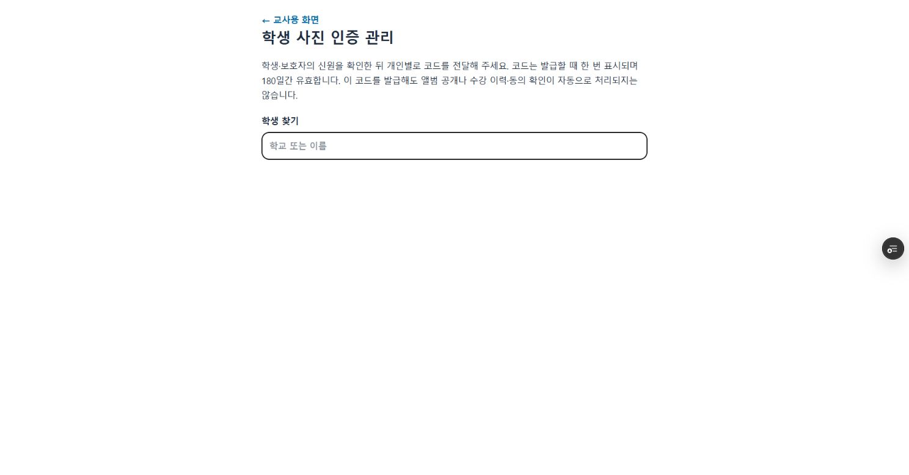

# 관리자 검증 및 인증 응답 진도 수정 — 2026-10-19

> 2026-10-19 후속 확인: 운영자가 이 대화에서 기존 사진 25장에 나온 모든 학생의 공개 동의를 이미 확인했다고 명시했다. 아래 이전의 동의 미확인 기록은 해당 발언 전 상태다. 동의 확인만 DB에 반영했으며 당시 명부와 학생 공개 차단은 그대로다.

## 운영자의 공개 동의 확인 반영

- 근거: 운영자가 2026-10-19 대화에서 “사진 25장에 나온 모든 학생의 공개 동의를 이미 확인하셨다는 뜻인가요?”에 “응”으로 답했다. 동의서 원문을 직접 열람한 것으로 취급하지 않고 운영자의 확인 진술로 기록했다.
- 대상은 기존 김포 하늘빛초 / A반 / 2026년 3분기 앨범 한 개다. 변경 전 revision=26, 사진 25장, consent_verified=false, published=false, roster_verified=false, 명부 0명을 읽기 전용으로 확인했다.
- 같은 revision과 비공개 상태, 빈 동의 기록, 활성 사진 25장 조건을 모두 만족할 때만 consent_verified=true와 근거 메모를 저장했다. 앨범 행을 잠그고 revision을 27로 증가시켰다. 학생 명부·공개 여부·사진·학생 계정·학습 이력은 수정하지 않았다.
- 별도 DB 재조회: consent_verified=true, published=false, roster_verified=false, 연결 학생 0명, revision=27. 사진 25개·원본 25개·썸네일 25개·화면용 25개, 버킷 비공개를 확인했다. 파일 합계는 25 × 3 = 75개다.
- 운영자는 명부를 출석부 또는 수강생 목록에서 확인할 수 있다고 안내했다. 저장소의 하늘빛초 “출석부 열기” 연결을 확인하고 외부 출석부 접속을 시도했으나 브라우저 연결 시간이 초과됐다. 실제 명부 대조 완료로 표시하지 않는다. 현재 학년으로 A/B반을 분류하는 코드만으로 당시 반을 확정하거나 명부를 자동 연결하지 않았다.
- 사진 공개 차단 환경변수·Firebase 규칙·Production 코드·계정 자격정보 변경 없음. 테스트용 계정은 아직 지정받지 않았다.

## 실제 로그인 후 관리자 확인

- 사용자가 로그인한 기존 Preview `history-explorer-kd2e0p3xq-sunclass.vercel.app`에서 교사 관리실, 학생 사진 인증 관리, 사진 보관함을 확인했다. 해당 Preview의 앱 코드는 이후 문서 커밋 `536f700`과 동일하다.
- `/teacher/student-security`의 서버 승인 후 학생 검색에 실제 결과가 표시됐다. 검색을 지운 상태의 화면만 아래에 보존하며 학생 이름·비밀번호·확인코드는 기록하지 않는다. 실제 학생의 확인코드를 발급·해제하지 않았다.
- `/teacher/photo-archive`에서 기존 하늘빛초 A반 2026년 3분기 비공개 앨범을 조회했다. 관리자 서버 API와 인증된 사진 요청이 성공했다.
- 사진 25개 버튼을 확인했고, 화면에 들어온 이미지 16개가 실제 디코딩됐다. 화면 밖 사진은 지연 로딩되므로 25개 이미지 전체 디코딩 완료로 취급하지 않는다. 관찰 시 로딩 실패 문구는 없었다.
- 1번 사진의 중앙 이동/확대, 2번 사진으로 중앙 전환, 다음 사진 버튼으로 3번, 오른쪽 방향키로 4번 전환을 확인했다. 중앙 사진 CSS transform은 translate(0px,0px), rotate(0deg), scale 약 2.28이었다. 갤러리를 새로 만들거나 수정하지 않았다.
- 실제 분기 종료일 2026-11-06 + 14일 = 2026-11-20이며, 관리자 화면에 `2026-11-20 23:59:59까지 (한국시간)`가 표시됐다.
- 명부/동의 확인은 미체크, 학생 공개는 미체크·disabled였다. 공개 설정을 변경하거나 저장하지 않았다.
- DB 재조회에서 활성 사진/원본/썸네일/화면용 파일 각 25개, 총 25 × 3 = 75개 파일과 비공개 버킷을 다시 확인했다. 당시 명부 0명, published/consent_verified/roster_verified=false도 유지됐다.

## 발견한 인증 회귀와 수정

- 이전 실제 학생 화면은 1권, 같은 학생의 관리자 화면은 9권으로 표시됐다. 원인은 서버 인증 응답 `studentProfile`의 `Number(data.stage || 1)` 변환이었다. 기존 진도는 `book_9` 등 문자열 ID도 사용한다. 이 값을 숫자로 바꾸면 NaN, JSON 응답에서는 null이 돼 학생 화면의 1권 기본값으로 표시된다.
- 수정 범위는 `lib/studentIdentity.ts`의 인증 응답 필드 한 곳이다. 기존 문자열 또는 유효한 숫자 진도를 그대로 전달하고, 다른 자료형은 1로 처리한다. 저장된 진도·학생 계정·비밀번호·차시/캐시 로직은 변경하지 않았다.
- `verify-student-sessions.cjs`에 실제 로그인/새로고침 복원/교사 미리보기 라우트 응답의 `book_9` 보존 검사를 추가했다. 수정 전 `null !== 'book_9'`로 실패해 재현했고 수정 후 통과했다.
- 기존 `9-2`, 숫자 33, 숫자 문자열 33, `book_23`도 실제 진도 해석기로 각각 9권/9권/9권/23권인지 JSON 직렬화 후 확인했다. 이 검사에는 합성 학생만 사용했다.
- 학생 응답의 허용 필드 목록은 유지한다. 비밀번호·연락처 등 비공개 필드를 추가로 반환하지 않는다.

## 실제 사진 직접 URL 검사

- Supabase의 프로젝트 URL과 DB에 존재하는 사진 1개의 원본/썸네일/화면용 경로를 조회하고 비로그인 HTTP GET을 수행했다. 비밀키·쿠키·Authorization은 사용하지 않았다. 대상 경로와 사진 내용은 보고서에 노출하지 않는다.
- 공개 URL 경로 3종은 모두 HTTP 400 JSON `Bucket not found / NoSuchBucket`로 거부됐다. DB에서 실제 객체 존재를 확인한 비공개 버킷의 표본이다.
- 인증 URL 경로 3종도 모두 HTTP 400 JSON `headers must have required property 'authorization' / InvalidRequest`로 거부됐다. 사진 데이터는 내려오지 않았다.
- 검사 수는 URL 방식 2종 × 사진 변형 3종 = 6개다. 표본 1개에 대한 비로그인 직접 접근 결과이며, 만료된 서명 URL이나 모든 학생·반의 실계정 권한을 검증했다고 확대하지 않는다.
- [Supabase 공식 URL 설명](https://supabase.com/docs/guides/storage/serving/downloads)의 public/authenticated 경로로 요청했다. 학생 앱은 별도 서명 다운로드 URL을 반환하지 않는 기존 구조를 유지한다.

## 이어서 확인한 실제 학생 화면과 명부

- 사용자가 로그인한 수정 후 Preview `https://history-explorer-ksfc9mg0b-sunclass.vercel.app/student/history` (커밋 `3c8f004`)에서 `별꼼역사 9권`을 확인했다. 2026-10-19 한국시간 새로고침 후에도 로그인과 9권 표시가 유지됐다. 이 결과는 앞선 진도 오류 수정의 실제 계정 재확인이다.
- 같은 Preview에서 기존 과제의 제출 버튼 3개, `지금 풀 교재문제가 없어요`, 은엽전 교환 신청기간 외 차단 안내를 확인했다. 사진 카드는 계속 계정 보안 점검 안내와 열람 가능한 앨범 없음으로 응답했다. 과제 제출·복습 완료·교환 신청은 하지 않았다.
- 기존 교사 로그인 Preview에서 하늘빛초 2026년 3분기 A반 앨범을 열었다. 실제 `2026-Q3` 이력이 있는 현재 학교 일치 후보 9개, 선택된 명부 0명, 명부/동의 확인 미체크, 학생 공개 미체크·disabled를 확인했다. 후보 9개를 당시 A반 학생 9명으로 해석하지 않는다. 현재 학교가 변경된 학생이나 당시 방과후 반은 실제 명부와 대조해야 한다.
- `enrollmentTerms`는 분기 이력 문자열 목록이며 당시 학교·반 기록은 포함하지 않는다. 학생별 기존 사진 동의 정보를 자동 연결하는 구현도 확인하지 못했다. 실제 명부와 공개 동의 근거 없이 계정을 선택하거나 확인 표시를 저장하지 않았다.
- 별도의 DB 재조회로 사진/원본/썸네일/화면용 파일 각 25개, 비공개 버킷, 앨범의 published/consent_verified/roster_verified=false 및 명부 0명을 확인했다. 운영 데이터 변경 없음.
- 브라우저 저장소 값의 직접 확인은 사용 중인 브라우저 읽기 환경에서 지원되지 않았다. 코드의 기존 `selectedStudent` 삭제, 비밀번호 저장 제거 및 격리 인증 검사를 근거로 하며 실제 브라우저 저장소 검사 완료로 표시하지 않는다.

## 공개기간 14일 상한 보완

- 기존 수동 공개 종료일은 분기 종료일 + 14일보다 뒤로 설정할 수 있었다. 예를 들어 분기 종료일 2026-03-31, 수동 종료일 2099-12-31인 합성 앨범이 2099년까지 공개되는 문제를 테스트에서 재현했다. 수정 전 상한 검사에서 `2099-12-31 !== 2026-04-14`로 실패했다.
- `archiveExpiry`가 실제 분기 종료일 + 14일을 항상 상한으로 계산한다. 이미 저장된 더 늦은 날짜도 목록·상세·사진 바이트 요청에서 상한을 넘길 수 없다. 운영 DB 레코드를 갱신하는 마이그레이션은 없다.
- 저장 API는 상한보다 늦은 수동 날짜를 HTTP 400으로 거부한다. 관리자는 더 이른 비공개 날짜를 선택할 수 있고, 날짜 입력의 최대값과 안내도 이에 맞췄다. 한국시간 종료일 23:59:59.999 허용 / 다음 날 00:00 차단, 관리자 원본 보존은 유지한다.
- 기존 실제 앨범의 수동 날짜는 null이므로 종료일은 그대로 2026-11-20 23:59:59 Asia/Seoul이다. 실제 사진 공개 차단은 해제하지 않았다.
- 수정 후 `verify-photo-archive.cjs` 통과: 저장된 연장 날짜 상한, 직접 API 연장 거부, 더 이른 종료, 연도/윤년 계산, 한국 자정의 실제 이미지 응답 200→404 및 원본 보존을 포함한다. 합성 계정·이미지·격리 DB 어댑터 검사이며 운영 앨범의 공개 설정은 바꾸지 않았다.
- `verify-student-sessions.cjs`, `verify-student-data-flow.mjs` 13/13, `verify-mybox-archive.cjs`, 실제 React/Chromium의 PC·모바일 갤러리/업로드/MYBOX UI 검사 모두 재통과했다. UI 첫 실행은 테스트 Chromium 글꼴 압축 해제 중 chown EINVAL로 시작하지 못했고, 이미 압축 해제된 공식 패키지 Chromium과 저장소 한국어 글꼴을 지정해 재실행했다. `--disable-web-security`를 제외하는 기존 실행 방식을 유지했다.
- 변경 후 전체 `npm run build` 통과: TypeScript 및 정적 페이지 70/70 생성 성공. 변경 범위는 공개기간 계산·저장 검증·관리자 날짜 안내와 관련 테스트/기록이며 인증 구현과 갤러리 구현은 그대로다.
- 배포 대상은 기존 `feat/student-auth-security-20261017` 브랜치의 Preview뿐이다. 최종 배포 URL/커밋/READY 상태는 Vercel 검증 결과로 별도 보고한다. 운영 DB 변경·Production 배포·main 병합은 없다.

## 완료와 한계

- 서버 세션·사진 권한 회귀, 학생 데이터 흐름 13/13 검사 통과. 로컬 전체 Next 빌드와 TypeScript, 정적 페이지 70/70 생성이 통과했다. 수정 커밋 `6e92edc98d9f1cd0b7b277720d1b38bceb11619a`의 Preview `https://history-explorer-jot81b3qc-sunclass.vercel.app`는 READY이며 원격 빌드 성공도 확인했다.
- 실제 관리자 로그인·앨범/인증 관리 조회는 위 기존 Preview에서 확인했다. 수정 후 Preview의 실제 학생 9권 표시와 새로고침 인증 유지도 위와 같이 재확인했다.
- 실제 과제 제출/복습 풀이/코인 교환/비밀번호 변경/확인코드 발급은 실행하지 않았다. 학습 이력과 자격정보를 변경하지 않는 범위의 실제 조회 검증이다.
- Firebase 운영 규칙은 아직 변경하지 않았다. 실제 당시 학교·반 명부 및 공개 동의가 확인되지 않아 사진 공개 차단을 유지한다. 실제 앨범으로 학교·반·분기별 허용·만료 검증은 남아 있다.
- 웹사이트 Production 배포·main 병합 없음.
