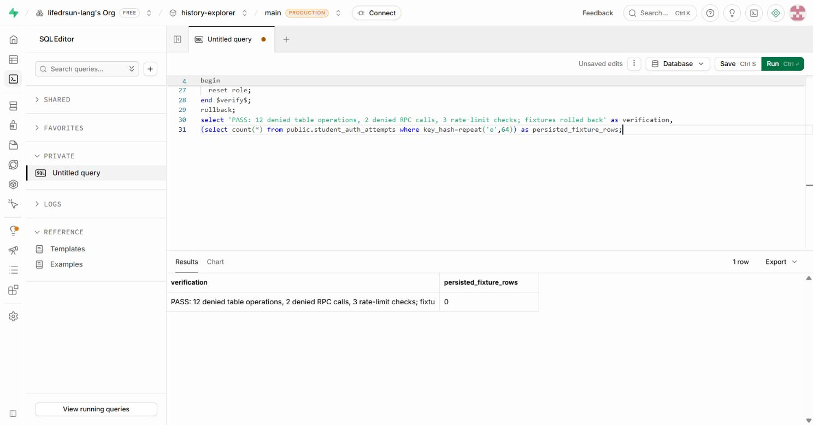

# 학생 인증 DB 실제 적용 검증 — 2026-10-18

## 적용

- 대상: Sun Lab / `history-explorer`, Supabase `yiowkxfvageewcmczsip` 기본 DB. 기존 운영 DB에 추가 전용 변경을 적용했다. 웹사이트 Production 배포와는 별개다.
- 사용자가 대시보드 대체 경로 및 준비된 SQL 적용을 승인한 뒤 Supabase에 직접 로그인했다.
- 저장소 커밋 `63a9d59ac519874c4b525c14318c22d745d370b5`의 `supabase/migrations/20261017010000_student_server_sessions.sql` 원문을 `begin`/`commit`으로 감싸 대시보드 SQL Editor에서 실행했다. 화면의 `Success. No rows returned`와 별도의 DB 메타데이터 조회로 적용을 확인했다.
- 새 테이블: `student_auth_sessions`, `student_photo_credentials`, `student_auth_attempts`. 새 함수: `consume_student_auth_attempt`, `cleanup_student_auth_state`. 기존 계정/비밀번호/수강/학습/사진 레코드 변경 없음. 만료 정리 함수는 생성만 했고 호출하지 않았다.
- 성공 검증 후 마이그레이션 버전 `20261017010000`을 적용 이력에 등록하고 재조회했다. 대시보드 수동 적용 이력은 statements를 비운 적용 완료 표식으로 기록했으며, 원문 SQL은 위 Git 커밋에 보존돼 있다. 재배포 시 동일 migration을 다시 만들지 않기 위한 기록이다.

## 실제 권한 검증

| 대상 | RLS | anon 테이블 접근 | authenticated 테이블 접근 | service_role 접근 |
| --- | --- | --- | --- | --- |
| student_auth_sessions | true | false | false | true |
| student_photo_credentials | true | false | false | true |
| student_auth_attempts | true | false | false | true |

- 두 함수 모두 `SECURITY INVOKER`, `search_path=public`, anon/authenticated EXECUTE false, service_role EXECUTE true를 카탈로그에서 확인했다.
- [실행 SQL](../scripts/verify-student-auth-db.sql)을 대시보드에서 실행: 2개 브라우저 역할 × 3개 테이블 × 읽기/쓰기 2종 = 12개 작업에서 permission denied, 2개 역할의 RPC 호출 차단, 서버 역할의 제한 2회 조건에서 첫 번째 true/두 번째 true/세 번째 false = 총 17개 검사 통과.
- 테스트 시도 횟수 데이터는 한 트랜잭션에서만 만들고 rollback했다. 후속 조회에서 해당 테스트 키 잔여 행 0개를 확인했다. 실제 학생 계정을 이용한 인증 테스트와는 구분한다.

## 보존 확인

- 실제 SQL 조인 조회: 활성 사진 25개, 원본 25개, 썸네일 25개, 화면용 파일 25개. 총 25 × 3 = 75개 파일 모두 존재하며 원본 버킷 public=false.
- 실제 사진은 계속 비공개다. 동의·당시 명부를 추정하거나 연결하지 않았다. 사진 공개 검토 환경변수를 켜지 않았다.
- 보안 Advisor에서 신규 3개 테이블에 `RLS Enabled No Policy` INFO가 표시됐다. 이 테이블들은 서버 전용이므로 브라우저 역할의 테이블 권한을 회수하고 정책을 만들지 않아 접근을 닫는 설계다. 일반 사용자 허용 정책을 추가하지 않았다. [Advisor 설명](https://supabase.com/docs/guides/database/database-linter?lint=0008_rls_enabled_no_policy)

## Preview 및 남은 작업

- 앱 코드는 변경하지 않았다. 검증 대상 Preview는 커밋 `63a9d59`의 `https://history-explorer-kd2e0p3xq-sunclass.vercel.app`이다.
- `/student` HTTP 200, 브라우저에서 실제 학교 목록과 하늘빛초 학교 비밀번호/학생 이름/출석번호 로그인 화면 렌더링을 확인했다. 학교 목록은 실제 서버 API 응답으로 로드됐다.
- 실제 학생 자격정보를 입력한 로그인, 새로고침 유지·로그아웃 무효화, 과제/복습/코인/차시 전체 실제 계정 회귀는 미완료다. 학생 비밀번호·계정 재설정이나 확인코드 발급은 하지 않았다.
- Firebase 규칙은 이 작업에서 변경하지 않았다. 학생 문서 공개 허용 문제와 Production 전환 전 규칙/코드 동시 전환 필요성은 기존 보고 그대로다.
- 웹사이트 Production 배포·main 병합 없음. 동의/명부 및 직접 URL·만료 접근의 실제 계정 검증 전에는 사진을 공개하지 않는다.
