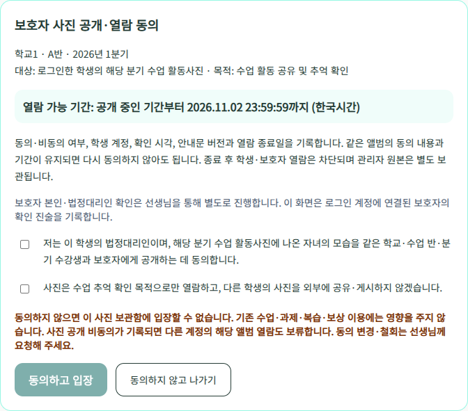
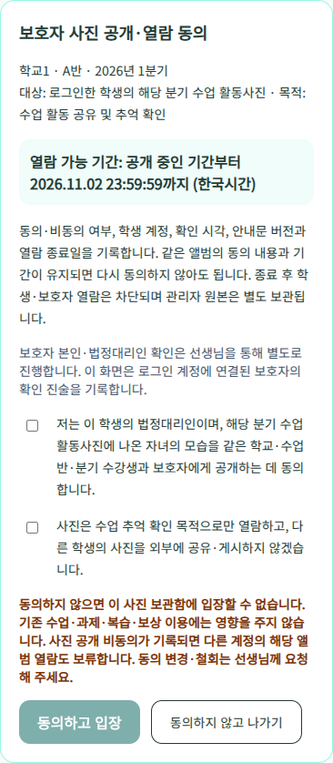
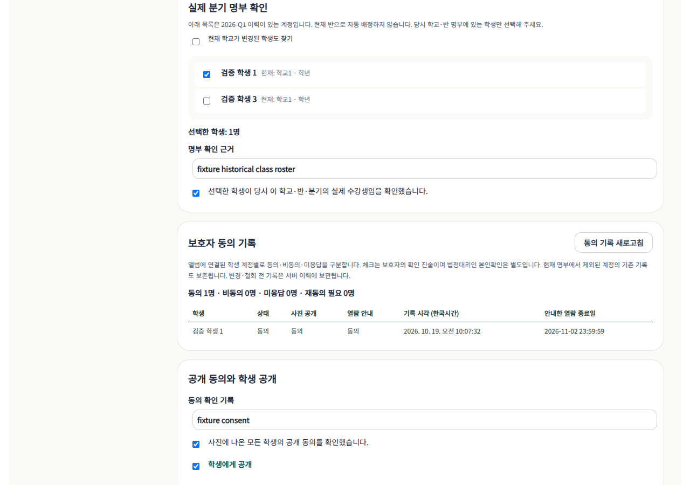

# 앨범별 최초 동의와 열람기간 안내 — 2026-10-19

## 요청과 동작

- 보호자의 사진 공개 동의와 사진 열람 안내를 별도 체크 항목으로 제공한다. 처음에는 둘 다 미선택이며, 둘 다 동의해야 입장 버튼이 활성화된다.
- 학생 계정과 앨범별로 서버에 저장된 최신 결정을 확인한다. 동일한 앨범·안내문·열람 종료일이면 다음 입장에는 동의 화면을 다시 띄우지 않는다. 브라우저 localStorage를 동의 근거로 쓰지 않는다.
- 앨범·분기는 구분한다. 안내문 버전이나 학교/반/분기/종료일 등 동의 범위가 바뀌면 재동의가 필요하다. 분기 종료일 + 14일 상한과 한국시간 종료일 23:59:59.999 / 다음 날 00:00 차단은 유지한다.
- 앨범 선택 화면과 사진 화면에 열람 종료일을 항상 표시한다. 비동의 시 사진 보관함 입장이 제한된다는 문구와 기존 수업·과제·복습·보상에는 영향을 주지 않는다는 문구를 표시한다.
- 명시적으로 나가기를 선택하면 비동의 결정을 기록한다. 사진 공개 항목은 현재 체크값을 기록하고, 열람 항목은 비동의로 기록한다. 아무 결정 없이 닫으면 미응답 상태를 유지한다.
- 사진 공개에 비동의한 최신 기록이 하나라도 있으면 다른 계정에도 해당 앨범의 사진 바이트를 반환하지 않는다. 사진은 삭제하지 않고 관리자에게 확인이 필요하다고 안내한다. 공개 동의는 유지하고 열람 안내에만 비동의한 경우에는 다른 계정의 열람을 막지 않는다.
- 같은 결정을 순차 재시도하면 이벤트를 중복 생성하지 않는다. 비동의 후 동의 등 명시적인 결정 변경은 새 이벤트로 추가하며 과거 기록을 덮어쓰지 않는다. 동의한 뒤 사진 화면에서 내용을 다시 확인·변경할 수 있다.
- 관리자 사진 화면에 학생 계정별 동의·비동의·미응답·재동의 필요, 항목별 상태, 기록 시각(Asia/Seoul), 해당 결정에 안내한 열람 종료일과 집계를 표시한다. 현재 명부에서 제외된 계정의 기존 결정도 보존해 표시한다.
- 명부의 내부 과목 코드 `byeolkkum_history`는 기존 과목 정의를 이용해 `별꼼역사`로 표시한다. 과목 값이 없는 학생의 운영 데이터를 채우거나 변경하지 않았다.

## 인증과 기록의 의미

- 기존 서버 학생 세션·개인 사진 확인코드·정확한 역사적 명부/분기·앨범 공개/관리자 동의 확인·열람기간 검사는 유지한다. 체크만으로 로그인 또는 사진 인증을 우회할 수 없다.
- API는 명부와 기간을 검증한 뒤 서버에서 결정한 학생 키, 안내문 버전·범위 해시, 날짜를 기록한다. 클라이언트가 보내는 타 학생 키나 임의 시각·종료일은 사용하지 않는다. 서버는 상세와 이미지 요청에서 저장된 동의를 재검사하고, 저장소 I/O 후에도 다시 검사한다.
- 이는 **로그인 계정에 연결된 보호자의 동의 진술 기록**이다. 실제 법정대리인 본인확인을 자동 완료한 것으로 표시하지 않는다. 화면에도 별도 보호자 확인이 필요하다고 명시한다. 기존 앨범의 전원 동의 확인과 개별 온라인 체크 기록도 서로 다른 데이터다.
- 운영 전 보호자 확인 절차와 동의 기록 보관·정리 기간을 별도로 확정해야 한다. 이 구현만으로 법적 동의 요건 전체를 충족한다거나 종이 동의서를 항상 대체한다고 판단하지 않는다. 현재 실제 사진 공개 차단은 유지한다.

## 실제 DB 적용 및 검사

- Supabase `yiowkxfvageewcmczsip`에 추가 전용 migration `student_photo_consent_events` 적용 성공. 적용 이력의 버전 `20261019005853`을 확인했고 저장소 migration 파일을 같은 버전으로 맞췄다. 파일은 공식 Supabase CLI 2.121.0의 `migration new`로 생성한 뒤 작성했다.
- 신규 테이블 `student_photo_consent_events`와 최신 결정 조회 함수 `photo_archive_latest_consents`만 추가했다. 기존 학생·학습·사진 테이블의 레코드는 갱신하지 않았다.
- 신규 테이블 RLS=true. 브라우저 anon/authenticated CRUD와 RPC 실행 권한 없음. 앱 서버 service_role은 SELECT/INSERT만 허용하고 UPDATE/DELETE는 허용하지 않는다. 함수는 SECURITY INVOKER, search_path=public이다.
- [실행 SQL](../scripts/verify-photo-consent-db.sql): 브라우저 2개 역할 × CRUD 4종 = 8개 작업 차단, RPC 2개 차단, 서버 UPDATE/DELETE 2개 차단 = 12개 거부 결과 확인. 서버의 결정 2건 추가·조회, 최신 동의 1건 선택, 다른 학생 필터, 이전 비동의 이력 2건 유지도 확인했다. 합성 앨범·합성 계정만 사용해 트랜잭션 전체를 ROLLBACK했다.
- 후속 재조회: 검증용 앨범 0개·검증용 이벤트 0개, 전체 실제 동의 이벤트 0개. 실제 보호자가 아직 이 화면에서 응답하지 않았으므로 개인별 동의를 만들어 넣지 않았다.
- 기존 앨범 재조회: 사진/원본/썸네일/화면용 파일 각 25개, 총 25 × 3 = 75개, 저장소 비공개. published=false, roster_verified=false, 명부 0명, 앞서 운영자가 확인한 앨범 consent_verified=true 유지.

## 코드 및 화면 검증

- `verify-photo-archive.cjs`: 미응답/비동의 상태의 상세·직접 이미지 접근 거부, 두 항목/보호자 진술/범위 검증, 다른 학생 키 변조 거부, 비동의→동의 이력 보존, 동일 결정 중복 방지, DB 실패 시 차단, 기간 변경 시 재동의, 사진 공개 비동의 시 다른 계정 보호, 기존 학교·반·분기·만료·원본 보존 검사 통과.
- `verify-photo-archive-ui.cjs`: 실제 React/Chromium과 격리 API/DB/storage로 두 체크 전 입장 버튼 비활성화, 한 항목만 체크 시 비활성화, 비동의 저장과 퇴장, 재동의 입장, 재입장 시 동의 화면 생략, 매 입장 종료일 표시, 관리자 기록 표 렌더링, 390px 가로 넘침 없음 확인. 기존 PC/모바일 갤러리·키보드·터치·업로드·MYBOX 회귀도 통과했다.
- UI 테스트의 첫 시도들은 임시 Chromium 경로 소실, 글꼴 경로 및 페이지 전환 문제로 실패했다. 공식 npm 패키지의 Chromium을 작업용 위치에 풀고 시스템 fontconfig와 저장소 한국어 웹폰트를 사용했다. 학생/관리자 검증은 별도 브라우저 프로세스로 분리해 전체 UI 검사를 재통과했다. `--disable-web-security`는 사용하지 않았다.
- `verify-student-sessions.cjs`, `verify-mybox-archive.cjs`, `verify-student-data-flow.mjs` 13/13 통과. 변경 소스와 테스트 ESLint, git diff --check 통과. 최종 앱 소스의 전체 Next 빌드·TypeScript·정적 페이지 70/70 생성 통과.
- React 검토: 서버 권한 확인, 동의 저장 성공 전 입장 차단, 체크박스 라벨/비활성화/모달 키보드 접근, 요청 결과 경합 보호, 무거운 갤러리 지연 로딩을 유지했다.

## 화면 증거와 배포 범위

아래는 실제 학생 사진·실계정이 아닌 합성 계정과 테스트 이미지로 렌더링한 화면이다. 화면의 날짜는 합성 앨범 종료일로 계산한 값이며 실제 앨범 날짜를 바꾼 것이 아니다.

- 작업 브랜치 `feat/student-auth-security-20261017`, Preview만 반영한다. 실제 학생 계정 테스트는 사용자가 직접 진행하겠다고 지정했다. 자동 검사를 실계정 완료로 표시하지 않는다.
- Firebase 운영 규칙 변경, 학생 사진 공개 차단 해제, 실제 역사적 명부의 임의 연결, Production 배포·main 병합 없음. 최종 Preview URL과 READY 상태는 배포 조회 결과로 별도 보고한다.
